# ExtractIQ

**AI document extraction for accounts payable.** Invoices, purchase orders and goods receipts come in by upload or email. ExtractIQ reads them with OCR and an LLM, checks them against business rules, and routes anything doubtful to a person. It then matches invoices against their PO (2-way) and goods receipts (3-way) and posts clean vendor bills to the ERP.

> Portfolio project. All bundled data is fictional (generated by `/samples/generate.mjs`). No real customer data.

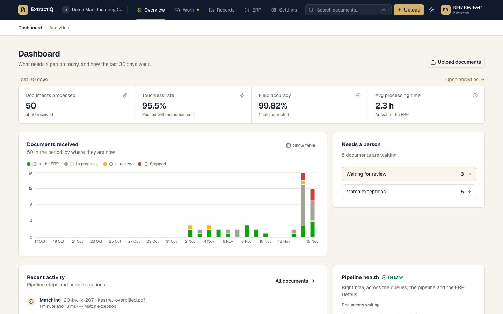

| | |
|---|---|
| **API** | Laravel 12 · PHP 8.3 · PostgreSQL · Sanctum SPA auth · Horizon (Redis queues) · Reverb (WebSockets) · Larastan |
| **Web** | Next.js 15 (App Router) · React 19 · TypeScript · Tailwind v4 · shadcn/ui · TanStack Query |
| **AI / OCR** | Swappable drivers: Claude (Anthropic SDK), OpenAI, offline heuristic · AWS Textract (AnalyzeExpense / AnalyzeDocument, sync + async), Tesseract, poppler text layer |
| **ERP** | Swappable connectors: Odoo 17 (JSON-RPC), QuickBooks Online, signed Webhook, Mock |
| **Tests** | 309 Pest tests (services, jobs, drivers, matching, ERP, analytics, API, security, tenant isolation) · Larastan level 5 · Playwright (43 flows + 2 sign-in setups) · CI on GitHub Actions |
| **Deploy** | Web on Vercel · API, Horizon, Reverb and scheduler on AWS EC2 (Forge) or a VPS with Docker + Caddy · `/api/health` + uptime workflow ([docs/DEPLOY.md](docs/DEPLOY.md)) |

---

## Contents

- [Screenshots](#screenshots)
- [Quick start (native)](#quick-start-native)
- [Quick start (Docker)](#quick-start-docker)
- [Demo walkthrough](#demo-walkthrough)
- [Architecture](#architecture)
- [The pipeline](#the-pipeline)
- [Drivers and configuration](#drivers-and-configuration)
- [Roles, security and the public demo](#roles-security-and-the-public-demo)
- [Adding an ERP connector](#adding-an-erp-connector)
- [Deployment](#deployment)
- [API](#api)
- [Testing](#testing)
- [Project layout](#project-layout)
- [Phase log](#phase-log)

---

## Demo video

[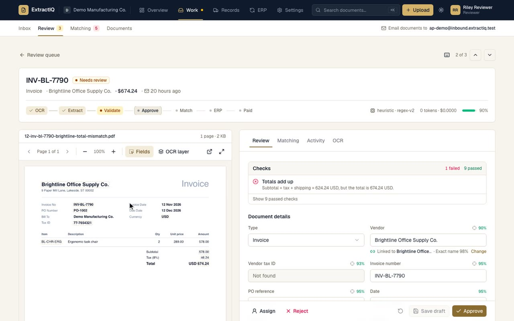](docs/demo/extractiq-demo.mp4)

[`docs/demo/extractiq-demo.mp4`](docs/demo/extractiq-demo.mp4): 2 min, 1920×1200, played at 0.8× speed. It's a straight recording of the running app with no edits or voice-over:

1. The landing page, then signing in.
2. The dashboard.
3. Fixing an invoice whose total doesn't add up, then saving and approving it.
4. The three-way match of an over-billed invoice.
5. A scanned invoice with the OCR layer on.
6. Analytics, then Settings → People & approvals.
7. Dark mode.

Re-record it with `make demo-video CHROMIUM_PATH=…` against the seeded stack (`web/scripts/demo-video.mjs`). The script drives a normal arrow, hand and I-beam pointer with eased movements, types at human speed, and scrolls smoothly. Chrome's screencast captures the frames at 1.5× density, and ffmpeg stitches them at their real timings, slowed by `SPEED` (default 0.8). The run approves one invoice, so the target reseeds afterwards.

## Screenshots

| | |
|---|---|
| 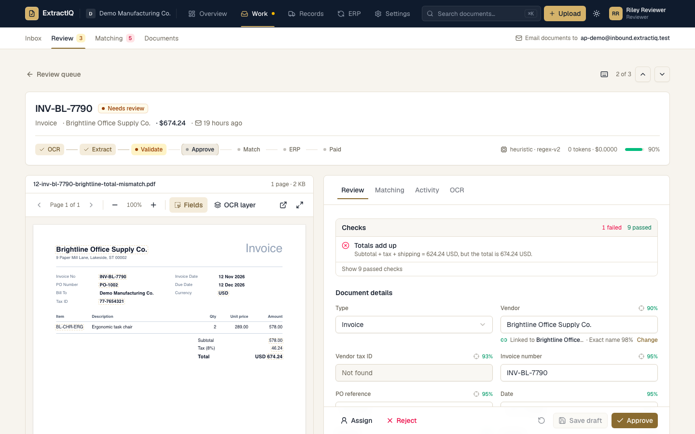 **Review:** the page next to the fields, failed checks first | 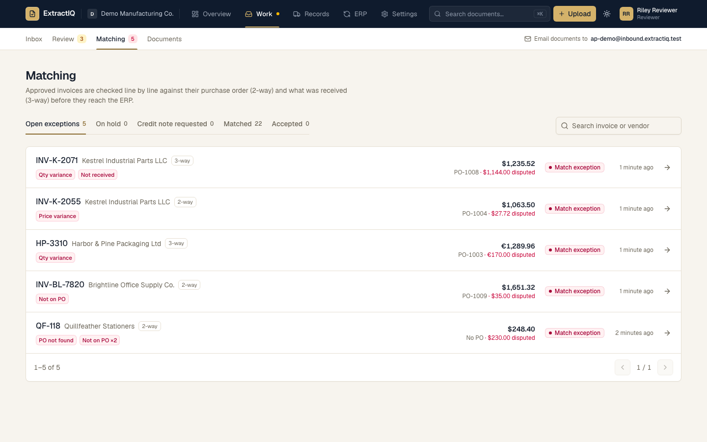 **Matching:** open exceptions with the reason |
| 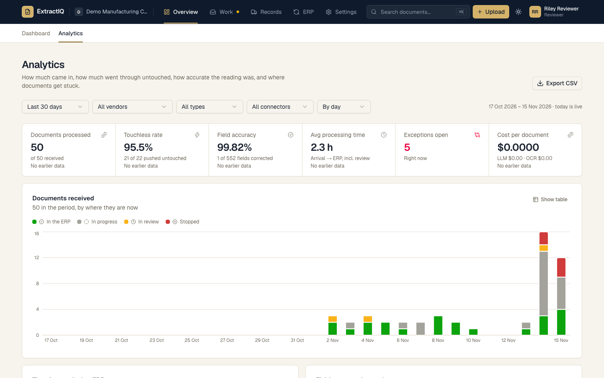 **Analytics:** KPIs, volume, exceptions, accuracy, pipeline health | 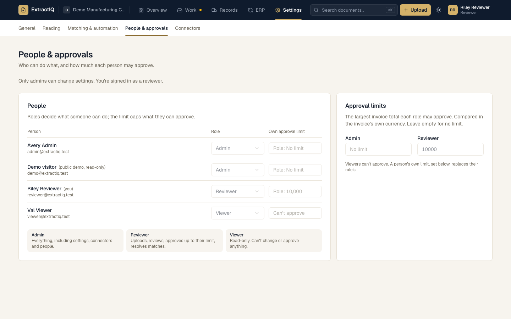 **Settings:** people, roles and approval limits |
| 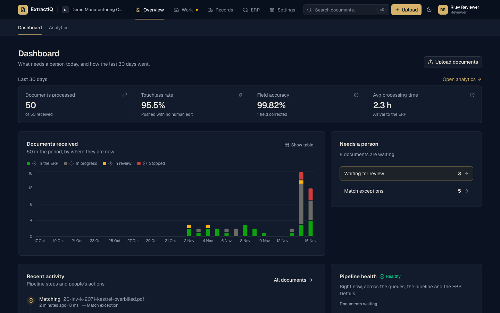 **Dark mode** | 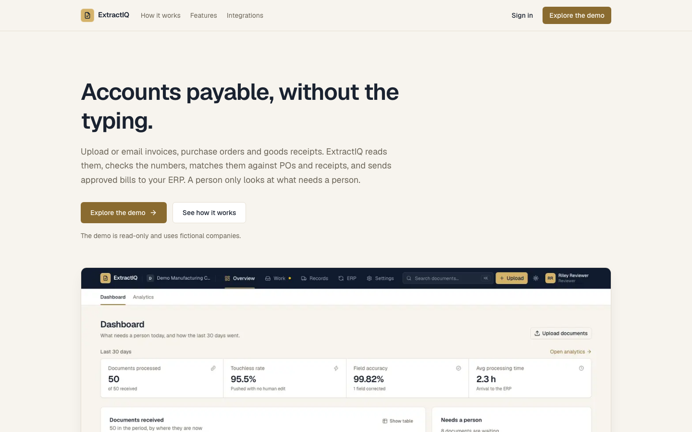 **Landing page** at `/` |
| 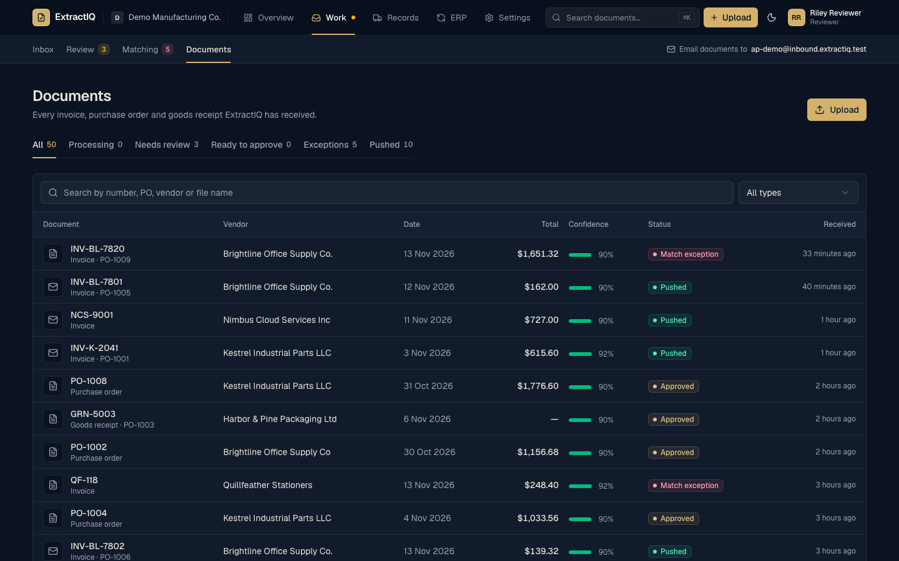 **Documents** in dark mode | 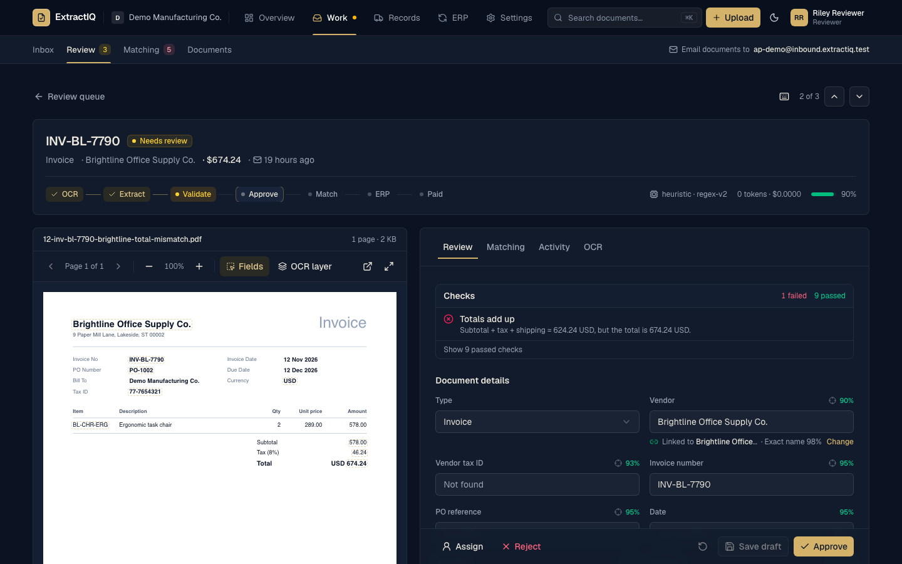 **Review** in dark mode |

<p>
  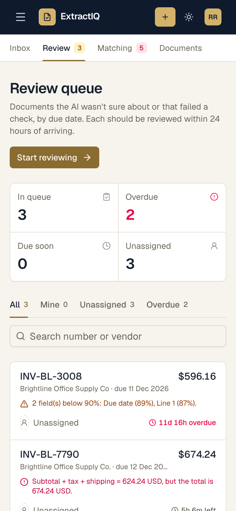
  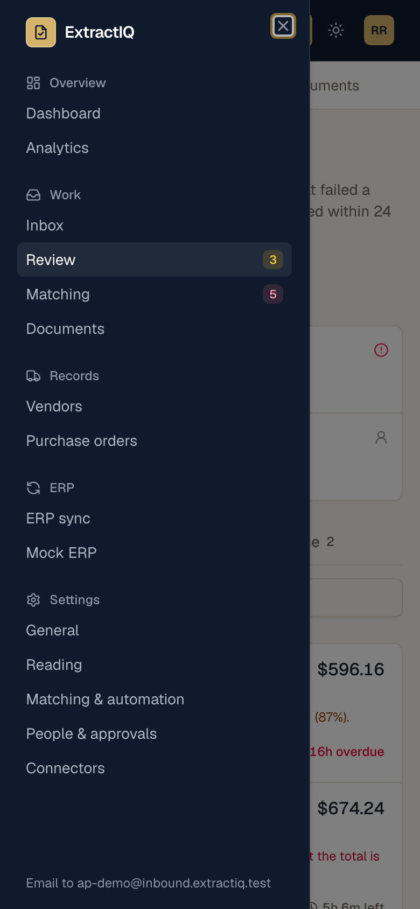
</p>


Refresh them with `node scripts/screenshots.mjs` from `web/`, with the seeded stack running. Rebuild the web app afterwards (`npm run build`), because Next.js only serves `public/` files that existed at build time, and the landing page shows the same dashboard and review images.

## Quick start (native)

Requirements: PHP 8.3 (`pdo_pgsql`, `pcntl`, `intl`), Composer, Node 20+, PostgreSQL 14+, Redis, **poppler** (`pdftoppm`/`pdftotext`, page images and the PDF text layer) and **Tesseract** (scans and images) — `brew install poppler tesseract`. For S3 storage without Docker: `brew install minio minio-mc` and `make minio`. Optional: Mailpit (email intake), Tesseract (scanned docs), Docker (for `make up`).

```bash
make install          # composer + npm installs, creates api/.env and web/.env.local
#   then edit api/.env: DB_* / REDIS_*, and run `cd api && php artisan reverb:install` for REVERB_APP_* keys;
#   copy REVERB_APP_KEY into web/.env.local as NEXT_PUBLIC_REVERB_APP_KEY
createdb extractiq    # or: make up  (Postgres, Redis, MinIO, Mailpit, Odoo in Docker)
make seed             # migrate:fresh + demo tenant, 3 users, vendors, and the sample PDFs run through the pipeline
make dev              # API :8030 · Horizon · Reverb :8031 · scheduler · web :3030  (one terminal, Ctrl-C stops all)
make test             # Pest + Larastan + web typecheck/lint
make e2e              # Playwright smoke test against the running stack
```

`make help` lists every target. Override binaries when needed, e.g. `make dev PHP=/opt/homebrew/opt/php@8.3/bin/php`; add `DOCKER=1` to run artisan inside the compose `api` container.

**Demo accounts** (password `password`):

| Role | Email | Can |
|---|---|---|
| Admin | `admin@extractiq.test` | everything, including delete and testing the ERP connection |
| Reviewer | `reviewer@extractiq.test` | upload, edit, approve, accept exceptions, manage vendors |
| Viewer | `viewer@extractiq.test` | read-only |

Swagger UI: <http://localhost:8030/api/docs> · Horizon: <http://localhost:8030/horizon> · Mailpit: <http://localhost:8025>

## Quick start (Docker)

```bash
make up               # Postgres 16, Redis 7, MinIO (+ bucket init), Mailpit, Odoo 17 + its Postgres — waits for healthchecks
make up-app           # the above + API, Horizon, Reverb, scheduler and web containers
make seed DOCKER=1    # seed inside the api container
make down
```

Every service has a healthcheck (`docker compose ps` shows health); app containers wait for Postgres, Redis, Mailpit and the MinIO bucket job to report healthy.

Set `DOCUMENTS_DISK=s3` in `api/.env` to store files in MinIO (the `extractiq` bucket is created for you). The API image includes Tesseract and poppler, so `OCR_DRIVER=tesseract` works for scans.

**Using Odoo:** open <http://localhost:8069>, create a database called `odoo`, and install *Invoicing*. Then set `ERP_DRIVER=odoo` and `ODOO_PASSWORD` in `api/.env`, and press **Settings → Test connection**.

> The compose file was validated by parsing only. Docker wasn't available on the machine this was built on, and everything was verified with the native setup.

## Demo walkthrough

After `migrate --seed`, the Mock ERP is loaded from `samples/erp/seed.json` and synced into master data (vendors, the 10 scenario POs PO-1001…PO-1010 plus 16 history POs PO-2001…PO-2016, and their receipts), the same way a real ERP is. Then the **50 sample documents (30 invoices, 10 purchase orders, 10 goods received notes)** are processed over the last 14 days and pushed to it. Finally some bills are posted and paid in the Mock ERP and synced back. The scenario documents cover each path through the pipeline:

| Sample (in `samples/pdf/scenarios`) | What happens |
|---|---|
| `01` PO-1001 + `02` GRN-5001 + `03` INV-K-2041 | Validated, approved, **3-way matched**, then pushed to the ERP |
| `04` PO-1002 + `05` INV-BL-7781 | **2-way matched**, then pushed |
| `06` PO-1003 (EUR) + `07` partial GRN + `08` HP-3310 | **Match exception**: invoiced 1,000, received 800 |
| `09` PO-1004 + `10` INV-K-2055 | **Match exception**: unit price 6% over the PO |
| `11` NCS-9001 | No PO number: the open PO-1007 is **found by vendor + amount**, matched, pushed |
| `12` INV-BL-7790 | **Needs review**: subtotal + tax ≠ total |
| `13` QF-118 | Unknown vendor (warning), then the match exception *PO not found* |
| `19` INV-K-2070 | PO-1008 (`24`) + GRN-5008 (`25`): billed exactly the **partial delivery**, 3-way matched, pushed |
| `20` INV-K-2071 | Same PO: **over-billing** (4 more hoses, but only 6 received and 6 already billed) and gloves **not received** |
| `21` INV-BL-7820 | Vendor's own SKUs, **paired by description**; a courier fee **not on the PO** |
| `22` HP-3320 | Vendor printed as "Harbour & Pine Packaging GmbH" with no tax ID: **resolved by fuzzy name**, matched, pushed |
| `bulk/invoice-hp-3006-de.pdf` | **German** invoice ("Rechnung", "Gesamtbetrag", 13.10.2026, 1.234,56): read, matched to PO-2006 and GRN-6003, pushed |
| `bulk/invoice-inv-k-3005-multipage.pdf` | **Two pages**, 40 lines, the table header repeated on page 2: all lines read, matched, pushed |
| `scans/14-scan-ncs-9050.pdf` | **Speckled photocopy** (image-only PDF): Tesseract, low-confidence words, no PO, needs review |
| `scans/29-scan-inv-bl-3008-skewed.pdf` | **Skewed scan** (1.4°): read by Tesseract, two fields under 90%, needs review |

The invoices use four layouts: classic (Kestrel, Harbor), a modern two-column layout with the vendor named only in the letterhead (Brightline), a compact one with "Invoice #" and "Amount due" (Nimbus), and the German one. Purchase orders and receipts use the buyer's template.

Things to try:

0. Sign in: you land on the **Dashboard** (what needs a person, the last 30 days, pipeline health). **Analytics** has the full picture with filters for period, vendor, type and connector, a table view behind every chart, and **Export CSV**.

1. Open **Review queue**, then INV-BL-7790. Fix the total (or tick *Calculate from lines*) and press **Ctrl+S**; the save re-validates and the status flips to *Validated*. **Ctrl+Enter** approves and opens the next document in the queue.
   On NCS-9050, press **Tab** to jump between the low-confidence fields and **Enter** to accept each one. Click a dashed box on the page to jump to its field.
2. Open **Matching**, then INV-K-2071: the three-column view puts each line's PO, goods receipt and invoice side by side, with the variance cells in red and the delta. Sign in as `admin@extractiq.test` to **Accept** a line (a reason is required), **Request credit note** for the disputed amount, or **Put on hold**. INV-BL-7820 shows lines paired by description.
   Under **Settings → Matching tolerances**, change the price or quantity tolerance, then **Re-run** an exception. Import more master data from **Purchase orders → Import POs** (try `samples/csv/purchase_orders.csv`; re-importing just updates).
3. Upload any PDF from `samples/pdf`. Re-uploading the same file is deduplicated. Change one byte to get a new document, which is then flagged as a duplicate invoice number.
4. Email a document: `node samples/send-email.mjs samples/pdf/scenarios/09-po-1004-kestrel.pdf`, then `php artisan extractiq:poll-mailpit`.
5. Keep two tabs open. Status changes arrive over Reverb, and toasts appear for *needs review*, *match exception*, *pushed* and *push failed*.
6. **ERP:** open **Mock ERP**, post or pay a draft bill, or **Receive remaining** on PO-1008. Then **ERP sync → Sync now**: the invoice moves to *Posted* or *Paid*, and INV-K-2071's *not received* line can match.
   As admin, **Simulate outage** on the Mock ERP card and approve an invoice to watch retries, a dead-letter after 5 tries with the ERP's message, and **Retry**. Click any push to see the request and response.
   **ERP sync → Field mapping** sets GL accounts, tax codes and cost centres. **Settings → Touchless processing** lets small, clean invoices skip review.

## Architecture

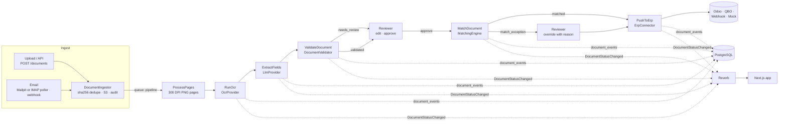

**Multi-tenancy.** Every business table has a `company_id`. The `BelongsToCompany` trait adds a global scope from the request-bound `Tenant`, which the `tenant` middleware sets before route-model binding runs. Queue jobs don't bind a tenant: they load by explicit id and write `company_id` explicitly. Reverb channels are `private-company.{id}` and authorized per user. Tests cover cross-tenant 404s and 403s on channel auth.

**Auth.** Sanctum **SPA mode**: the web app calls `GET /sanctum/csrf-cookie`, then `POST /api/v1/auth/login` from an origin listed in `SANCTUM_STATEFUL_DOMAINS` (`localhost:3030`) and gets an HttpOnly session cookie. Writes carry `X-XSRF-TOKEN`, and nothing is stored in `localStorage`. Reverb private channels authorize with the same cookie. Non-browser clients (curl, Swagger, integrations) call the same login endpoint and receive a bearer token in `meta.token`.

**Money and dates.** Amounts are stored as integer minor units (`*_minor`) plus an ISO 4217 code. Exponent-aware helpers handle JPY (0) and KWD (3). Dates are ISO 8601.

**API style.** REST under `/api/v1`, with JSON:API-style resources (`type/id/attributes/relationships`, `included`, `meta.page`, `links`) and JSON:API error objects carrying `source.pointer`.

## The pipeline

```
received → ocr_done → extracted → needs_review | validated → approved → matched | match_exception → pushed | push_failed
pushed → posted → paid      (bill status read back from the ERP by the scheduled sync)
received → failed            (OCR gave up after 3 attempts; the reason is kept and "Retry" moves it back to received)
```

The machine is enforced by `DocumentStatus::allowedTransitions()`. `Document::transitionTo()` throws on an illegal move, which the API returns as a 409. Purchase orders and goods receipts stop at `approved`, because they are the reference data for matching. Approving one re-queues any invoice waiting in `match_exception` on that PO.

Every step is a queued job (`app/Jobs`) extending `PipelineJob`. The first step, **ProcessPages**, keeps the status at `received`. It renders each PDF page to a 300 DPI PNG with poppler's `pdftoppm` (image uploads become a single page) and saves `document_pages` rows with width, height and DPI. OCR then fills in the text for the same rows. If page rendering keeps failing, the pipeline logs it and carries on to OCR without images.

All steps share these properties:

- **Idempotent.** A job only acts when the document is in one of its accepted input statuses. Otherwise it records a `skipped` event and exits. `PushToErp` also checks `erp_pushes.idempotency_key`, so a bill is never created twice, and each connector deduplicates on its own side (Odoo `ref`, QBO `DocNumber`, webhook `Idempotency-Key`).
- **Unique** per document until processing starts (`ShouldBeUniqueUntilProcessing`), so a double dispatch can't run a step twice in parallel.
- **Retried** 3 times with backoff `[10, 60, 300]` seconds. Non-retryable provider errors (bad credentials, a refusal, malformed output, 4xx) fail immediately.
- **Audited.** Every attempt writes a `document_events` row with `step`, `status` (succeeded/failed/skipped/info), `from_status`, `to_status`, `duration_ms`, `attempt`, `error` and `meta`. Human actions (review, approve, override, retry) are written there too, with the acting user.
- **Ordered.** A step dispatches the next one only after its own event is recorded (`then()`), so the audit trail stays in order even on the sync queue.

**Extraction** (`ExtractFields`). Each document type has a versioned JSON Schema in `api/resources/schemas` (`invoice.v1`, `purchase_order.v1`, `goods_receipt.v1`). `SchemaRegistry` derives the *extraction* schema from it, in which every field is `{value, confidence, source}`. That schema is enforced with structured output (Claude `output_config.format`, OpenAI strict `json_schema`), and the server re-validates every reply anyway.

The prompt contains the OCR as visual rows prefixed with line ids (`[p1.l7] Invoice No: INV-K-2041`), plus OCR key/values and tables and the vendor's learned hints. The model cites line ids. `SourceResolver` turns those into exact **word ids** by matching the value's tokens inside those lines, so the UI can highlight where each value came from. A field's final confidence is min(model confidence, OCR confidence of its source words).

Documents that are still `unknown` after the OCR keyword rules are classified by the LLM first. Tokens and cost are stored per document, priced from the per-model table in `config/extractiq.php`.

**Validation** (`DocumentValidator`). Errors block approval: required fields, line maths (qty × price), lines that don't sum to the subtotal, subtotal + tax ≠ total, a due date before the issue date, and duplicate invoice numbers per vendor (the earliest copy wins). Warnings only flag: unknown vendor, low confidence (below `REVIEW_CONFIDENCE_THRESHOLD`), missing PO, future date. A reviewer's save re-validates synchronously, and once a person has looked, warnings alone no longer block.

**Master data and matching** (`app/Services/Matching`). Invoices are matched against master data, not against other documents:

- **Master data:** `vendors` (name, aliases, tax ID, ERP ref, default currency), `purchase_orders` + `po_lines`, `goods_receipts` + `grn_lines` (each linked to its PO line).
  - It comes from CSV imports, the ERP sync (Phase 6) and approved PO / GRN documents, all through `MasterData`.
  - Upserts are keyed by normalised number. ERP and CSV are the systems of record: an extracted PO never overwrites one of theirs, it only links itself.
  - When master data changes, invoices waiting in `match_exception` that could now match are matched again (`Rematcher`).
- **Vendor resolution** (`VendorResolver`), in order: exact tax ID (1.00) → exact name or alias (0.98) → trigram similarity on name and aliases (pg_trgm in Postgres, the same algorithm in PHP for SQLite tests), taken when one candidate leads clearly → an **LLM tie-break** between close candidates (capped at 0.90).
  - The method and confidence are stored on the document and shown in review. A fuzzy or AI match is a warning to check.
  - A reviewer can pick the vendor by hand and remember the printed name as an alias.
- **PO lookup** (`PurchaseOrderLocator`): by the printed PO number ("po 1001" = "PO-1001"); otherwise among the vendor's open POs, scored on how close the invoice net is to the PO's remaining value and how many lines appear on it. Ambiguous cases are not guessed.
- **Line pairing** (`LineMatcher`): SKU first. Otherwise description trigram similarity blended with price and quantity proximity (vendors often print their own SKUs). Several invoice lines may bill one PO line (one-to-many), and partial quantities are fine.
- **Line results** (`MatchingEngine`), worst first: `not_on_po` › `not_received` › `qty_variance` › `price_variance` › `matched`.
  - 2-way checks price and quantity against what was ordered. 3-way also checks what was received, with the **over-billing guard**: quantity invoiced across all matched invoices may not exceed quantity received. Invoices still in dispute don't consume quantity.
  - The header is `matched` only if every line is matched or accepted and there's no header issue: PO not found or closed, vendor or currency mismatch, or a total variance (invoice net vs PO prices beyond the total tolerance, after line-level differences).
- **Tolerances per company** (Settings): unit price ±% or ± amount (whichever is larger), quantity +%, total ± amount, matching mode (auto / 2-way / 3-way), and who may accept a variance. Defaults are the `MATCH_*` variables.
- **Actions** on an exception, each with a reason and a `document_events` row: accept one line or all variances (role-gated), request a credit note for the disputed amount, put on hold or release (a held invoice is never pushed), re-run. Every run is kept, and older ones are marked `is_current = false`.

## Deployment

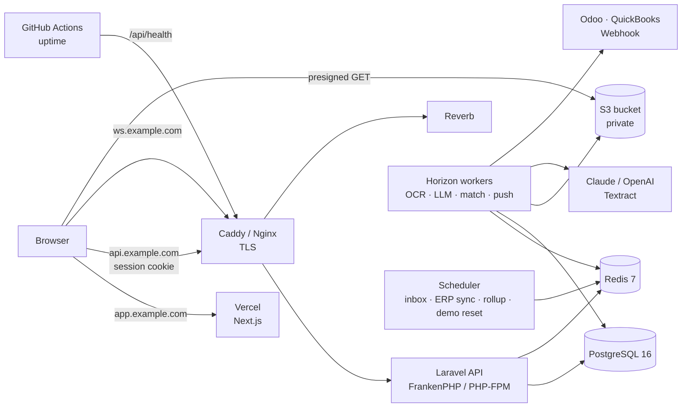

Configs live in `deploy/` (Docker + Caddy for a VPS, Forge script and daemons for EC2) and `.github/workflows/` (CI, uptime). [docs/DEPLOY.md](docs/DEPLOY.md) walks through domains and Sanctum cookies, S3 CORS, Vercel, the public demo, health checks and a go-live checklist. Nothing was deployed from this repository: that needs your own accounts.

## Drivers and configuration

**OCR output.** For each page, `document_pages.ocr` (jsonb) holds `{words, lines, key_values, tables}`. Words and lines are `{text, bbox:[x,y,w,h] as 0–1 ratios, confidence}`. Key/values come from Textract FORMS or expense summary fields, or for the local providers from "Label: value" lines. Tables come from Textract TABLES or expense line items. `document_pages.ocr_raw` keeps the provider's own payload (Textract blocks, Tesseract TSV rows, poppler boxes). Documents that arrive as `unknown` are classified from OCR keywords (title lines weigh more). Weak evidence leaves the type undecided for the LLM. Each document records `type_source` (declared, classifier, llm or manual).

**Storage.** Originals go to the documents disk (`DOCUMENTS_DISK=s3` → MinIO or AWS S3; `local` for quick experiments) at `{company}/{yyyy}/{mm}/{uuid}.{ext}`. Page images sit next to them at `{company}/{yyyy}/{mm}/{uuid}/page-{n}.png`.

Each provider is an interface with drivers resolved by a Laravel `Manager`. Switch drivers in `api/.env`; add new ones with `app(OcrManager::class)->extend('name', fn () => …)`.

| Interface | Drivers | Notes |
|---|---|---|
| `OcrProvider` (`OCR_DRIVER`) | `pdftext` (default), `tesseract`, `textract` | All three return the **same normalised shape** per page (see below). **Textract** uses AnalyzeExpense for invoices and AnalyzeDocument (TABLES + FORMS) for POs, GRNs and unknown documents. Single pages are sent synchronously; multi-page PDFs use async jobs on the S3 original, with polling and `NextToken` paging, and a retry resumes the same job. **Tesseract** runs on the 300 DPI page images. **pdftext** reads a digital PDF's text layer with poppler (exact word boxes, confidence 1.0) and hands scans and images to Tesseract. |
| `LlmProvider` (`LLM_DRIVER`) | `anthropic`, `openai`, `heuristic` (default) | All drivers share one prompt and one strict JSON schema (`ExtractionSchema`). **Claude** goes through the official `anthropic-ai/sdk`: it sends the PDF as a document block plus the OCR text, uses structured outputs (`output_config.format`), defaults to `claude-opus-5-5` at effort `medium`, and enables server-side refusal fallback (`fallbacks: "default"`). **OpenAI** uses Chat Completions with a strict `json_schema`. **heuristic** is an offline regex extractor, so the stack runs with no API key, in CI, and in the demo seed. |
| `ErpConnector` (active per company on ERP Sync; `ERP_DRIVER` is the default) | `mock` (default), `odoo`, `quickbooks`, `webhook` | `testConnection`, `syncVendors`, `syncPurchaseOrders`, `syncReceipts`, `pushVendorBill`, `getBillStatus`, plus `capabilities()`. See **ERP connectors** below. |

Secrets live only in `.env`; `.env.example` lists every variable. The other main settings are `REVIEW_CONFIDENCE_THRESHOLD` (default 0.90), `AUTO_APPROVE_VALIDATED`, the `MATCH_*` defaults, the `ERP_*`, `ODOO_*` and `QBO_*` connector settings, `DOCUMENTS_DISK` (`local` or `s3`/MinIO) and `INBOUND_EMAIL_SECRET`.

**ERP connectors** (`app/Services/Erp`). Each company has an `erp_connections` row per connector: its state (connected / error, last test, last sync), the field mapping, and for QuickBooks the OAuth tokens (encrypted). Configured secrets stay in `.env`.

| Connector | Bill | Sync back | Notes |
|---|---|---|---|
| **Odoo 17** (JSON-RPC) | `account.move` `in_invoice`, partner by tax ID or name, lines with product (SKU = `default_code`), GL account (by code), purchase taxes (by name from the tax mapping), analytic distribution (cost centre), and `purchase_line_id` linking each line to the PO line. The PDF is attached (`ir.attachment`, main attachment). | Suppliers, confirmed `purchase.order` + lines, incoming `stock.picking` (or the lines' `qty_received` without Inventory), bill `state` / `payment_state` | `make odoo-seed` installs Purchase, Inventory and Invoicing and creates the demo vendors, 51 products and the 10 scenario POs PO-1001…PO-1010 (confirmed; `--all` adds the 16 history POs), validating their receipts. |
| **QuickBooks Online** (OAuth 2.0, sandbox) | `Bill` for the Vendor; lines whose SKU is an Item become item lines with `LinkedTxn` to the PurchaseOrder line, others are account lines on the mapped GL account; `TaxCodeRef` and `ClassRef` (cost centre) from the mapping; PDF uploaded as an `Attachable` | Vendors, PurchaseOrders, bill balance (paid at 0) | "Connect to QuickBooks" runs the authorization-code flow; tokens refresh automatically (and once more on a 401). QuickBooks has no goods receipts, so it's 2-way unless receipts come from documents or CSV. |
| **Mock ERP** | A bill in the in-app ERP (`mock_erp_*` tables) with its own screens: post, record payment, receive deliveries | Vendors, POs, receipts, bill status | Demo without credentials; loaded from `samples/erp/seed.json`. "Simulate outage" makes pushes fail with 503 to show retries and dead-lettering. |
| **Webhook** | Signed JSON (`X-ExtractIQ-Signature: sha256=HMAC(body)`, `Idempotency-Key` = document uuid), header fields under the mapped names, and a 7-day signed link to the original file | — | For Zapier, n8n or a custom bridge. |

- **Field mapping** (ERP Sync → Field mapping, per connector): our header fields → ERP fields (a choice of what that ERP accepts; free text for webhooks), the default GL account, tax rate → tax code, and cost-centre rules by vendor with an optional GL account override.
- **Pushing** (`PushToErp`): only invoices that are approved and matched (or whose variances were accepted), never while on hold. The idempotency key is the document uuid. A key that already succeeded is never sent again, and each connector also checks on its side.
  - Every attempt is logged in `erp_pushes` with the request, the ERP's response, HTTP status and duration.
  - 5 attempts with backoff (`ERP_PUSH_TRIES`, `ERP_PUSH_BACKOFF`), then the push is dead-lettered: `push_failed`, with the ERP's message on the document and in the push log, until someone uses Retry. Errors that retrying can't fix (validation, credentials) dead-letter at once.
- **Sync** (`extractiq:erp-sync`, every 15 minutes, or "Sync now"): vendors, purchase orders and receipts into master data (source `erp`, with ERP refs on PO lines so receipt lines link exactly), then the status of every pushed bill (`pushed → posted → paid`). Each part runs on its own and the run is recorded in `erp_sync_runs`. Exceptions waiting on the synced POs are matched again.
- **Touchless processing** (Settings, per company): a validated invoice from a known vendor below the limit is approved without review (`documents.touchless`); if it matches, it goes straight to the ERP. If not, it waits in Matching.

**Analytics** (`app/Services/Analytics`, `GET /api/v1/analytics`).

- **Rollup:** `analytics_daily` has one row per company × day × vendor × document type × connector, with additive measures, so any range and filter is a cheap sum.
  - `extractiq:analytics-rollup` rebuilds the last 30 days nightly at 01:15, because statuses keep moving after a document arrives.
  - Older days that were never rolled up are built on demand, and today is always computed live.
- **Attribution:** each measure counts on the day of its own event. Arrivals, status mix and cost count on `received_at`; pushes, touchless count and processing time on `pushed_at`; field accuracy and spend on `approved_at`; exception reasons on the match date; ERP attempts on the attempt date.
- **Definitions:**
  - *Processed:* past OCR and extraction.
  - *Touchless:* pushed with no reviewer correction, accepted variance or vendor change.
  - *Field accuracy:* 1 − corrected / extracted fields on approved documents. A corrected field is a header field a person changed, or a line item they changed, added or removed. It's also shown separately for documents read with learned vendor hints.
  - *Cost per document:* LLM tokens plus OCR pages (Textract list prices, `OCR_COST_*`) per document received.
- **KPIs** come with the previous period of the same length. **Pipeline health** is "right now": Redis queue depth per queue and job, documents waiting per stage, failed jobs, ERP pushes in the last 24 h, and the last sync per connector.

**Email ingestion** has two entry points. Both resolve the tenant by recipient (`ap-<slug>@inbound.extractiq.test`):

- `POST /api/v1/inbound/email`: provider-neutral JSON with base64 attachments, authenticated by an HMAC-SHA256 signature of the raw body.
- `php artisan extractiq:poll-inbox` (scheduled every minute; `make dev` runs the scheduler). It reads unread mail from `INBOUND_MAIL_DRIVER`: `mailpit` (local REST API) or `imap` (any IMAP server, via webklex/php-imap; no PHP `imap` extension needed). It ingests PDF and image attachments with the sender and subject, and marks only those messages read. Mail for other recipients is left untouched, so a shared Mailpit or catch-all mailbox is safe.

## Roles, security and the public demo

| Role | Can |
|---|---|
| **Admin** | Everything: settings, connectors, people and roles, delete, audit-log export. Approves without limit by default. |
| **Reviewer** | Upload, correct, approve up to their **approval limit**, resolve matches, manage vendors. |
| **Viewer** | Read-only. Bank details in extracted data are masked. |

- **Roles and approval limits:**
  - Roles are enforced by route middleware. The UI hides or disables what a role can't do, but the API is the authority.
  - Approval limits are set per role in **Settings → People & approvals** (default: reviewer 10,000, admin unlimited). A person can also have their own limit, which replaces their role's.
  - Limits are compared in the invoice's own currency, with no FX. Approving above the limit returns `403` with a sentence explaining why, and the review screen says so before you try.
- **Per-company settings:**
  - Matching tolerances, touchless processing and the OCR and LLM providers. Only drivers whose keys exist on the server can be chosen, and a choice falls back to the default if its key is later removed.
  - The inbox address, approval limits and people.
  - ERP connectors (ERP Sync).
- **Tenant isolation:** every business table has a `company_id`, with a global scope plus a tenant middleware that runs before route-model binding. `tests/Feature/Security/TenantIsolationTest.php` runs a second company through the real pipeline (ERP sync, extraction, approval, matching, push). Then it calls **every authenticated route** with that company's ids as an admin of the first company and expects 404 each time. It also checks that every list and export comes back empty.
- **Signed file links:** the viewer asks `GET /documents/{id}/file-url` for a link that expires after 5 minutes. On S3 or MinIO that's a presigned URL; on local disk it's a Laravel signed route. The bucket stays private.
- **Masking:** `App\Support\Pii` masks IBANs, labelled account, routing and SWIFT numbers, and long digit runs (`DE89 •••• 3000`). A Monolog processor applies it to every log channel, and it's also used in the audit export and in API responses for viewers.
- **Rate limits:** per user (or IP) per minute. API 600, uploads 30, exports 10, and login 10 per email + IP. All are configurable.
- **Audit log:** Settings → General → Audit log downloads every pipeline step and human action as CSV, with who, when and what changed. Admin only, at most a year per file, with masked bank details and formula-safe cells.
- **Public demo:**
  - Turn it on with `DEMO_MODE=true` on the API and `NEXT_PUBLIC_DEMO_MODE=true` on the web.
  - "Explore the demo" on the landing page signs visitors in as a read-only demo user. They see everything an admin sees, but every write returns `403 demo_read_only`. A banner reads "Demo data — fictional companies".
  - `extractiq:demo-reset` (nightly at 03:30) drops and reseeds only the demo tenant. In demo mode the named seed accounts get random passwords.
- **Health:** `GET /api/health` reports the database, Redis, storage, Horizon workers and the scheduler heartbeat. It answers 503 when the database or Redis is down.

## Adding an ERP connector

SAP, NetSuite, Xero and others plug in the same way as the built-in connectors. Using NetSuite as the example:

1. **Implement the interface:** create `api/app/Services/Erp/Drivers/NetSuiteConnector.php` implementing `App\Services\Erp\ErpConnector`.
   ```php
   final class NetSuiteConnector implements ErpConnector
   {
       public function __construct(private array $config, private ErpContext $ctx) {}
       public function name(): string { return 'netsuite'; }
       public function capabilities(): array { return ['sync_vendors' => true, 'sync_purchase_orders' => true, 'sync_receipts' => true, 'bill_status' => true, 'attachments' => true]; }
       public function testConnection(): array { /* GET a cheap endpoint; return ['ok' => true, 'message' => 'Connected to …'] */ }
       public function syncVendors(): array { /* [['erp_ref' => 'netsuite:123', 'name' => …, 'tax_id' => …], …] */ }
       public function syncPurchaseOrders(): array { /* [['header' => [...], 'lines' => [[..., 'erp_ref' => …]]], …] */ }
       public function syncReceipts(): array { /* lines carry po_line_erp_ref so they link exactly */ }
       public function pushVendorBill(ErpBill $bill): PushResult { /* send, using $bill->idempotencyKey */ }
       public function getBillStatus(string $ref): ?BillStatus { /* posted / paid / cancelled, or null if unknown */ }
   }
   ```
2. **Map the bill:**
   - `ErpBill` carries the header, lines, the PO and receipt links, and the original PDF.
   - `ErpMapping` gives you the GL account, tax codes and cost centres the user picked in **ERP Sync → Field mapping**.
   - Throw `new ErpException($message, retryable: false, response: …, httpStatus: …)` for errors that retrying can't fix (validation, credentials). It dead-letters at once. Retryable errors (timeouts, 5xx, 429) back off and try again.
   - Make `pushVendorBill` idempotent on `$bill->idempotencyKey` (the document uuid): look the bill up first, or send it as the ERP's external id.
3. **Register it:** add `'netsuite' => new NetSuiteConnector($config, $ctx)` to the `match` in `ErpManager::make()`. For a package, use `app(ErpManager::class)->extend('netsuite', fn (array $config, ErpContext $ctx) => new NetSuiteConnector($config, $ctx))` in a service provider.
4. **Configure it:**
   - Add a `netsuite` block to `config/extractiq.php` (`erp.drivers`) that reads its secrets from `.env`, and list the variables in `.env.example`.
   - Add `'netsuite'` to `ErpConnection::CONNECTORS` and the ERP fields our header fields may go to in `ErpMapping::TARGETS['netsuite']`.
5. **Test it:**
   - Copy the shape of the Odoo tests in `tests/Feature/Erp/ErpConnectorsTest.php`: `Http::fake()` the ERP and assert the request payloads, idempotency, error mapping and status sync.
   - `TenantIsolationTest` covers the new routes automatically.

The UI needs no changes. The connector appears on **ERP Sync** with its capabilities, mapping editor, test button and push log.

## API

The full spec is in [`api/docs/openapi.yaml`](api/docs/openapi.yaml) (it passes `redocly lint`) and is served as Swagger UI at `/api/docs`.

```
POST   /api/v1/auth/login                    GET  /api/v1/dashboard
GET    /api/v1/auth/me                       GET  /api/v1/activity
POST   /api/v1/auth/logout                   GET  /api/v1/matches?filter[result]=open
GET    /api/v1/documents?filter[status]=…    GET  /api/v1/vendors      POST/PATCH/DELETE
POST   /api/v1/documents          (files[])  GET  /api/v1/integrations
GET    /api/v1/documents/{id}                POST /api/v1/integrations/erp/test
PATCH  /api/v1/documents/{id}/extraction     POST /api/v1/inbound/email  (signed)
DELETE /api/v1/documents/{id}
GET    /api/v1/documents/{id}/file | /pages | /pages/{n}/image | /pages/{n}/ocr[?include=raw] | /events | /matches
GET    /api/v1/purchase-orders                GET  /api/v1/erp-pushes
POST   /api/v1/documents/{id}/approve | /reject | /reopen | /reassign | /retry | /override-match | /hold | /release
GET    /api/v1/documents/{id}/match          POST /api/v1/documents/{id}/match/accept | /match/lines/{line}/accept | /match/credit-note | /match/rematch
PATCH  /api/v1/documents/{id}/vendor         GET  /api/v1/purchase-orders/{id}    GET /api/v1/goods-receipts
POST   /api/v1/imports/{vendors|purchase_orders|goods_receipts}    GET /api/v1/imports/{kind}/template
GET    /api/v1/settings/matching             PATCH /api/v1/settings/matching
GET    /api/v1/erp/connections               POST /api/v1/erp/connections/{c}/test | /activate     PATCH /api/v1/erp/connections/{c}/mapping | /settings
POST   /api/v1/erp/sync                      GET  /api/v1/erp/sync-runs      GET /api/v1/erp-pushes/{id}
GET    /api/v1/erp/quickbooks/connect | /callback     POST /api/v1/erp/quickbooks/disconnect     GET /api/v1/erp/files/{uuid} (signed)
GET    /api/v1/mock-erp/bills[/{id}]         POST /api/v1/mock-erp/bills/{id}/post | /pay     POST /api/v1/mock-erp/purchase-orders/{id}/receive
GET    /api/v1/settings/automation           PATCH /api/v1/settings/automation
GET    /api/v1/analytics?from&to&group_by&vendor&type&connector     GET /api/v1/analytics/export (CSV, same filters)
GET    /api/v1/review-queue?filter[assignee]=me|unassigned&filter[sla]=overdue|due_soon
GET    /api/v1/users                         PATCH /api/v1/users/{id}   (admin: role, approval_limit)
GET    /api/v1/settings/providers | /approvals          PATCH /api/v1/settings/providers | /approvals   (admin)
GET    /api/v1/documents/{id}/file-url[?page=n]   → short-lived signed link     GET /api/v1/files/{uuid} (signed)
GET    /api/v1/audit-log/export?from&to&document_id   (admin, CSV)
POST   /api/v1/auth/demo   (DEMO_MODE only)          GET /api/health   (outside /v1)
```

## Testing

```bash
make test         # Pest (309, in-memory SQLite, sync queue, fake storage) + Larastan level 5 + web tsc/eslint
make e2e          # Playwright against the running stack (make seed + make dev first)
#   use a cached Chromium:  make e2e CHROMIUM_PATH=/path/to/chrome
```

The Pest suite covers:

- Security (Phase 8):
  - Tenant isolation on every authenticated route, plus lists and exports.
  - Approval limits, including currencies with no or three decimals.
  - Role and people management, including keeping at least one admin.
  - Provider settings used by the pipeline.
  - PII masking, in logs too; viewer masking.
  - Signed links (local and S3), including tampered and expired ones.
  - Rate limits; the audit CSV (masking and formula safety); health.
  - Demo mode: read-only and the scoped reset.
- The German, letterhead and two-column extraction cases.

- The status machine and money parsing.
- OCR drivers, using a real sample PDF and faked Tesseract processes.
- The heuristic extractor, against the sample PDFs.
- The Claude driver through the real SDK with a fake PSR-18 transport. It asserts the structured-output schema, the PDF document block and the fallback beta, plus refusal and 429 handling.
- OpenAI with a faked HTTP client.
- All four ERP connectors, including Odoo's JSON-RPC sequence and idempotency, and the QBO payload.
- Each pipeline job end to end, plus retries and final failure, idempotent re-dispatch, dedupe and auto-approve.
- The validator rules.
- The matching engine: each variance type, partial and multiple deliveries, over-billing across invoices, one-to-many and description pairing, PO lookup by amount, header issues, per-company tolerances.
- Vendor resolution (tax ID, alias, trigram, LLM tie-break), CSV import, match actions and roles, holds, and document → master-data sync.
- Every API endpoint, including tenant isolation, roles, and the inbound-email signature.
- Broadcast payloads.

`e2e/portfolio.spec.ts` covers Phase 8:

- The landing page: hero, the four steps, features, integrations, the call to action, and phone width.
- Every Settings section.
- An approval limit blocking approval until it's raised.
- Originals loading through signed links.
- A viewer seeing settings read-only.

`e2e/erp.spec.ts` covers ERP sync: connector cards and the last sync, the push log viewer, the document's ERP link, posting a bill in the Mock ERP and syncing it back, field mapping, touchless settings, and phone width.

`e2e/matching.spec.ts` covers matching: the exceptions list, the three-column view with deltas, description pairing, PO progress and receipts, how the vendor was matched, and (as admin) hold and release, the accept and credit-note dialogs, vendor CSV import, and editing tolerances. The setup project signs in both a reviewer and an admin.

`e2e/review.spec.ts` covers the review workspace: queue order, counts, SLA timers and assignment; Tab/Enter through low-confidence fields and J/K between documents; clicking a field box on the page; line-grid recalculation with the reconcile indicator; and reject then reopen. Each test leaves the seed data as it found it.

The Playwright smoke test signs in once (a setup project saves the session cookie) and covers: landing on the Inbox with all nine sidebar sections and the tenant name, Analytics / Purchase Orders / ERP Sync rendering data, filtering and opening a review item, uploading a PDF and watching it run through the live pipeline, the read-only viewer on Matching (with no credentials in web storage), and dark mode.

## Project layout

```
extractiq/
├── CLAUDE.md                  project rules (the brief)
├── docs/DESIGN.md             design rules, mandatory for every screen
├── docs/DEPLOY.md             Vercel + Forge/EC2 or VPS + Docker, demo mode, health, CI
├── docs/screenshots/          README screenshots (web/scripts/screenshots.mjs)
├── docs/demo/                 extractiq-demo.mp4 + poster (web/scripts/demo-video.mjs, `make demo-video`)
├── deploy/                    docker/ (production image, compose, Caddyfile) · forge/ (deploy script, daemons)
├── .github/workflows/         ci.yml (Pest, Larastan, ESLint, build, Playwright) · uptime.yml
├── Makefile                   install · up · up-app · down · seed · dev · test · e2e · odoo-seed · erp-sync
├── README.md
├── infra/
│   ├── docker-compose.yml     postgres 16, redis 7, minio + bucket init, mailpit, odoo 17 + postgres; app profile
│   ├── api.Dockerfile         PHP 8.3 + pdo_pgsql, pcntl, tesseract, poppler
│   └── web.Dockerfile
├── api/                       Laravel 12
│   ├── app/
│   │   ├── Enums/             DocumentStatus (state machine), DocumentType, UserRole
│   │   ├── Events/            DocumentStatusChanged (Reverb)
│   │   ├── Http/              v1 controllers, JSON:API resources, tenant + role middleware
│   │   ├── Jobs/              PipelineJob → RunOcr, ExtractFields, ValidateDocument, MatchDocument, PushToErp
│   │   ├── Models/            Company, User, Vendor, Document, DocumentPage, DocumentLine, DocumentEvent, ErpPush;
│   │   │                      PurchaseOrder, PoLine, GoodsReceipt, GrnLine, DocumentMatch, MatchLine
│   │   ├── Console/Commands/  extractiq:demo, extractiq:poll-mailpit
│   │   └── Services/
│   │       ├── Ocr/           OcrProvider + PdfText, Tesseract, Textract
│   │       ├── Llm/           LlmProvider + Anthropic, OpenAI, Heuristic; shared ExtractionSchema
│   │       ├── Erp/           ErpConnector + Odoo (OdooClient), QuickBooks (QuickBooksOAuth), Webhook, Mock;
│   │       │                  ErpBill, ErpMapping, ErpSync, MockErp
│   │       ├── Analytics/     AnalyticsRollup (nightly analytics_daily), AnalyticsReport, PipelineHealth
│   │       ├── Matching/      MatchingEngine, LineMatcher, PurchaseOrderLocator, BillingLedger, VendorResolver,
│   │       │                  MasterData, CsvImporter, MatchActions, MatchSettings, Rematcher
│   │       └── Pipeline/      Ingestor, EmailIngestor, ExtractionApplier, Validator, Workflow, EventRecorder
│   ├── database/              migrations, factories, DemoSeeder
│   ├── docs/openapi.yaml      OpenAPI 3.1 (Swagger UI at /api/docs)
│   ├── phpstan.neon           Larastan level 5
│   └── tests/                 Pest: Unit + Feature (Api, Pipeline, Services, Matching)
├── web/                       Next.js 15
│   ├── src/app/login/
│   ├── src/app/(app)/         dashboard (home), analytics, inbox, documents, documents/[id], review, matching, matching/[id], vendors,
│   │                          purchase-orders, purchase-orders/[id], erp-sync, erp-sync/[connector], mock-erp,
│   │                          analytics, settings
│   ├── src/components/app/    shell, auth (Sanctum SPA), realtime, review form, match workspace, import dialog, timeline, upload
│   ├── src/components/ui/     shadcn/ui
│   ├── src/hooks/queries.ts   TanStack Query hooks
│   └── e2e/                   auth.setup.ts + smoke, review and matching specs (Playwright)
└── samples/
    ├── generate.mjs           fictional PO / GRN / invoice PDF generator
    ├── send-email.mjs         email samples into Mailpit
    ├── manifest.json
    ├── csv/                   vendors, purchase_orders, goods_receipts (CSV import examples)
    ├── erp/seed.json          demo ERP data: vendors, 51 products, 26 POs (16 marked bulk), receipts (Mock ERP + Odoo seed)
    └── pdf/{scenarios,bulk,scans}/  30 invoices, 10 POs, 10 GRNs: 4 layouts, 1 German, 1 two-page, 2 scans (1 skewed)
```

## Phase log

### Navy and gold (2026-11-15)

- **New palette:** deep navy top bar, warm ivory canvas, navy ink text and antique gold as the only accent: buttons, links, active tabs and the logo tile. Dark mode is night navy with light gold.
- **Contrast:** in light mode the gold is `#8A6B30`, so it passes WCAG AA as link text and under ivory button labels. The brighter gold is used only on navy.
- **Utility classes:** a `brand` gold scale and a `navy` scale replace Tailwind's indigo across the app.
- **Charts:** gold and steel blue, re-validated with the dataviz script in both themes. The status colours were re-checked against the new dark cards.

### Navigation redesign (2026-11-15)

- **No sidebar any more.**
  - An ink top bar holds the logo, the workspace, five areas (**Overview**, **Work**, **Records**, **ERP**, **Settings**), search (⌘K), upload, theme and account.
  - A light section bar underneath shows the current area's pages as underline tabs with live counts: Review and Matching waiting, failed ERP pushes. An amber dot on an area means something in it is waiting.
- **Content:** full width (up to 1400px).
- **Settings:** its sections are now tabs in the section bar.
- **Phones:** a drawer lists every area and page.
- **Demo banner:** now a full-width strip in the accent colour.
- **Where it lives:** `AREAS` in `web/src/components/app/app-shell.tsx`. The rules are in `docs/DESIGN.md`.

### Phase 8: portfolio-ready (2026-11-14)

- **Samples:**
  - The generator makes exactly 30 invoices, 10 POs and 10 GRNs for fictional vendors.
  - Four invoice layouts: classic, modern two-column, compact and German.
  - One two-page invoice with 40 lines, and two image-only scans: a speckled photocopy and a skewed page.
  - The 16 history invoices are matched against orders that exist only in the demo ERP (`"bulk": true`; `odoo-seed --all` creates them in Odoo).
  - The seeder runs everything through the real pipeline.
- **Extraction:**
  - German labels, `dd.mm.yyyy` dates and `1.234,56` amounts.
  - A letterhead fallback for the vendor name (never the bill-to party), IBANs with spaces, and the classifier knowing "Rechnung".
  - Vendor memory now learns labels on two-column layouts too.
- **Roles and settings:**
  - Approval limits per role and per person, enforced by the API and shown in review.
  - Admins manage people and roles; at least one admin is always kept.
  - Per-company OCR and LLM provider, used by the pipeline jobs.
  - Settings is split into General, Reading, Matching & automation, People & approvals and Connectors.
- **Security:**
  - Named rate limits.
  - Signed, expiring file links (presigned S3); the viewer uses them.
  - PII masking of bank details in every log channel, the audit export and viewer responses.
  - Audit-log CSV export.
  - The route-sweeping tenant isolation test.
- **Public demo:** `DEMO_MODE`, `POST /auth/demo` (a read-only visitor), the demo banner, `/demo`, and `extractiq:demo-reset` nightly.
- **Landing page** at `/`:
  - Hero with a real screenshot, how it works in 4 steps, a feature grid, an integrations strip (Odoo and QuickBooks built in, SAP and NetSuite ready via the connector interface, Webhook) and a call to action to the demo.
  - Lighthouse: mobile 96 / 100 / 100 / 100, desktop 100 / 100 / 100 / 100 (performance / accessibility / best practices / SEO).
- **Deploy and operations:**
  - Production Docker image (FrankenPHP), compose with Caddy for a VPS, and a Forge script and daemons for EC2.
  - Vercel notes and `docs/DEPLOY.md`.
  - `/api/health` and a scheduler heartbeat; GitHub Actions CI (Pest, Larastan, typecheck, ESLint, build, Playwright on the full stack) and an uptime workflow.
- **Tests:** 309 Pest (+44) and 45 Playwright (+5 flows).

### Phase 7: analytics and the home dashboard (2026-11-14)

- **Home dashboard** (`/dashboard`, now the landing page after sign-in): what needs a person (review, exceptions, failed pushes, unreadable documents), 30-day KPIs, documents received by status, pipeline health and recent activity.
- **Analytics page:**
  - KPI tiles: documents processed, touchless rate, field accuracy, average processing time (arrival → ERP), open exceptions, and LLM + OCR cost per document, each compared with the previous period.
  - Charts (Recharts): volume per day / week / month by status group, processing-time distribution, top vendors by spend (per currency, never converted), exception reasons, and weekly accuracy for all documents vs those read with learned vendor hints.
  - Pipeline health: queue depth per job, documents waiting per stage, failed jobs, ERP push success rate, and last sync per connector.
  - Filters for date range (presets or custom), vendor, document type, connector and grouping, kept in the URL. **CSV export** of the series.
- **Backend:** `GET /api/v1/analytics?from&to&group_by&vendor&type&connector` and `/analytics/export`, served from the nightly `analytics_daily` rollup (`extractiq:analytics-rollup`, 01:15) plus live numbers for today. The demo seed builds the rollup.
- **Charts follow the dataviz method:**
  - The volume stack uses the fixed status steps plus a neutral, ordered so green and red never touch. Adjacent colour-blind separation is ≥ 13.7 ΔE in light and dark, checked with the validator.
  - Every series has an icon and label in its legend, and every chart has a table view.
  - Single-hue bars, a 2 px surface gap, no dual axes. The previous render is kept while a new range loads.
- **Tests:** 12 Pest tests (every KPI definition, touchless exclusions, status groups and grouping, distribution, rankings, reasons, ERP success, hinted accuracy, previous period, rollup/backfill/live today and the nightly schedule, filters and validation, CSV, health, tenant isolation) and 5 Playwright flows.

### Phase 6: ERP connectors (2026-11-14)

- **`ErpConnector` interface:** `testConnection`, `syncVendors`, `syncPurchaseOrders`, `syncReceipts`, `pushVendorBill(bill)`, `getBillStatus(ref)`, and `capabilities()`. Connectors are built per company from `erp_connections` (active connector, state, mapping, tokens).
- **Odoo 17** over JSON-RPC: an `in_invoice` linked line by line to the `purchase.order`, with product, account, taxes, analytics and the original PDF attached. Syncs partners, POs, receipts and payment state. `make odoo-seed` (the `extractiq:odoo-seed` command) seeds vendors, products and 10 confirmed POs with receipts.
- **QuickBooks Online:** OAuth 2.0 connect / callback / refresh / disconnect, a Bill linked to the PurchaseOrder (`LinkedTxn`), item or account lines, tax codes and classes, and the PDF as an Attachable. Syncs vendors, POs and payment.
- **Mock ERP:** an in-app fake ERP with its own screens (bills to post and pay, POs to receive, vendors) and an outage switch. **Webhook:** signed JSON with mapped field names and a signed file link.
- **Field mapping UI** per connector: fields, default GL account, tax codes, and cost-centre rules by vendor.
- **PushToErp:** approved + matched (or accepted) only, idempotency key = document uuid, the ERP ref and link stored, 5 tries with backoff, then dead-lettered with the ERP's message in the UI. Every attempt is logged with its request and response.
- **Scheduled sync** every 15 minutes: vendors, POs and receipts into master data, and bill status back (`pushed → posted → paid`, two new statuses). Runs are recorded, and waiting exceptions are re-matched.
- **Web:**
  - **ERP sync:** connector cards (Connected / Error / Not configured, Active, Test connection, Make active, Connect to QuickBooks, Simulate outage), the last sync and Sync now, and a push log with dead-lettered and failed tabs, a request/response viewer and Retry.
  - The **field mapping** page and the **Mock ERP** screens.
  - On the document page, the **ERP link** with posted and paid status, and the dead-letter message.
- **Touchless processing** (optional, per company): validated + known vendor + total below the limit → approved without review, and pushed if it matches.
- **Demo data:** `samples/erp/seed.json` (vendors, products, the 10 scenario POs and their receipts), shared by the Mock ERP and the Odoo seed. The demo seed now gets its master data from an ERP sync instead of CSV.
- **Tests:**
  - 32 new Pest tests: every connector against faked Odoo JSON-RPC, QuickBooks REST and OAuth, and webhook endpoints; the Odoo seed; push rules, retries, dead-lettering, idempotency and holds; the sync (including posted/paid and re-matching), mapping validation, the Mock ERP API and the touchless rule.
  - 7 Playwright flows.
- **Changes in behaviour:**
  - The idempotency key is now the document uuid (was `extractiq-{company}-{id}`).
  - `erp_pushes` keeps every attempt instead of one row per document.
  - `QBO_ACCESS_TOKEN` / `QBO_REALM_ID` are replaced by the OAuth app settings (`QBO_CLIENT_ID`, `QBO_CLIENT_SECRET`, `QBO_REDIRECT_URI`).
- **Not run here:** Odoo and QuickBooks were exercised against faked endpoints only. The build machine has no Docker for the Odoo container, and a QuickBooks sandbox needs your Intuit developer app.

### Phase 5: master data and the matching engine (2026-11-14)

- **Master data tables:**
  - `vendors` gain `aliases`, a normalised tax key and a source.
  - New `purchase_orders` + `po_lines`, and `goods_receipts` + `grn_lines`, each GRN line linked to a PO line.
  - `document_matches` was rebuilt to point at them, with new `match_lines`. Matches are derived data, so they're recomputed by re-running matching.
- **Sources:** CSV import for vendors, POs and receipts (one row per line, bad rows reported by number, the rest imported, safe to re-import). The ERP sync in Phase 6 will reuse the same `MasterData` upserts. Approved PO and GRN documents become master data automatically.
- **Vendor resolution:** tax ID → alias → trigram (pg_trgm) → LLM tie-break, with method and confidence stored and shown. Manual pick can remember the printed name as an alias. `LlmProvider` gained `chooseVendor()` (Claude, OpenAI and the offline driver).
- **PO lookup** by number, or by vendor + open POs + amount. **Line matching** by SKU, then description similarity with price and quantity proximity. One-to-many and partial lines are supported.
- **Per-line results:** matched, price_variance, qty_variance, not_received, not_on_po. The header is matched or match_exception. The over-billing guard covers invoices across the same PO line, and the money at stake is computed per line.
- **Tolerances per company:** price % and amount, quantity %, total amount, mode, and who may accept. Editable in Settings by admins.
- **Web:**
  - **Matching:** tabs for open, on hold, credit note requested, matched and accepted, with per-kind variance chips and the disputed amount.
  - **Match detail** (also the document's Matching tab): PO | goods receipt | invoice columns per line, variance cells in red with the delta, and actions to accept a line or all, request a credit note, hold or release, and re-run.
  - **Purchase orders** with received and billed progress, PO detail per line, a goods receipts tab, and CSV import. **Vendors** with aliases and import. The review form shows how the vendor was matched, with a picker.
- **Samples:** `samples/csv/*.csv` (the "ERP export") and four new scenarios (19–22): partial delivery, over-billing + not received, vendor SKUs + a charge not on the PO, and a vendor trading-name variant. NCS-9001 is now found by vendor + amount.
- **Tests:**
  - 52 new Pest tests: each variance type, partial and multiple deliveries, over-billing across invoices, one-to-many, description pairing, PO lookup by amount and refusing to guess, header issues, tolerance settings, vendor resolution including the LLM tie-break, CSV import, match actions and roles, holds, and document → master-data sync.
  - 11 new Playwright flows.
- **Changes in behaviour:**
  - Accepting a variance needs the admin role by default (configurable). The old `POST /override-match` still works and accepts everything.
  - `MATCH_TOTAL_TOLERANCE_PCT` and `MATCH_QTY_TOLERANCE` are replaced by `MATCH_TOTAL_TOLERANCE_ABS` and `MATCH_QTY_TOLERANCE_PCT`.

### Phase 4: review workspace (2026-11-14)

- **Split view:** the page viewer on the left (zoom, page navigation, OCR layer, full screen), the editable form on the right.
  - A dashed box marks each extracted field on the page: amber if it's below 90% confidence, green once accepted, gold otherwise. Clicking a box focuses its field; focusing a field highlights its source words.
  - Fields below 0.90 get an amber *Low confidence · NN%* chip with an **Accept** action. Failed rules show red messages under the field they concern.
- **Line items:** SKU, description, qty, UoM, unit price, tax % and amount; rows can be added and removed.
  - Changing qty or price recalculates the amount. *Calculate from lines* derives subtotal, tax (per-line tax rates, or the document's original tax ratio) and total.
  - A *Totals reconcile* indicator shows the difference when lines ≠ subtotal or subtotal + tax + shipping ≠ total.
- **Keyboard:** Tab / Shift+Tab move between the low-confidence fields that haven't been accepted yet. Enter accepts one and moves on. Ctrl/Cmd+S saves the draft, Ctrl/Cmd+Enter approves (with any pending edits), and J / K go to the next or previous document in the queue. A keyboard icon lists the shortcuts.
- **Actions:** Save draft, Approve, Reject (with a reason; Reopen undoes it) and Reassign.
  - Each writes a `document_events` row with who, when, and a field-level diff: `before`/`after` per field, lines added, removed or changed, and fields accepted.
  - New status `rejected`. Documents gain an assignee and a rejection reason.
- **Review queue page:** needs_review documents sorted by due date. Counts for in queue, overdue, due soon and unassigned. Tabs for All, Mine, Unassigned and Overdue, plus search.
  - Each row shows the top issue, confidence, an assignee avatar with an assign menu, and a live SLA timer (`REVIEW_SLA_HOURS`, default 24h; amber in the last 4h). Phones get a stacked list.
  - Inside a document opened from the queue, the header shows "2 of 5" with previous and next.
- **API:**
  - `PATCH /documents/{id}/extraction` takes the corrections plus `accepted` keys; the old `PATCH /documents/{id}` is an alias.
  - `POST /approve` accepts the same body to fix and approve in one call.
  - New: `POST /reject`, `/reopen` and `/reassign`, `GET /review-queue` (counts, SLA and the full order for J/K) and `GET /users`.
  - Corrections still teach the vendor memory from Phase 3. Edited and accepted fields become human-verified (confidence 1.0), so a fully checked document validates.
- **Tests:** 10 new Pest tests (diffs, line diffs, accepted fields, vendor memory via /extraction, approve with pending edits, approve refused while a check fails, reject/reopen, reassign, queue order/counts/SLA, users) and 6 Playwright flows.

### Phase 3: AI extraction (2026-11-14)

- **Schemas:** versioned JSON Schemas for invoice, PO and GRN. The invoice schema covers vendor (name, tax id, address, email), number, dates, PO, currency, subtotal, tax, shipping, total, payment terms, bank (account, SWIFT) and line items (line_no, sku, description, qty, uom, unit_price, tax_rate, amount).
- **Prompt and providers:** the prompt is the OCR rows with line ids, plus key/values, tables, vendor hints and the schema.
  - Claude (official SDK, structured output, the original PDF attached) and OpenAI (strict JSON schema) use the model from `.env`. The offline heuristic driver returns the same shape.
  - Every reply is re-validated against the schema.
  - Each field carries a value, a confidence, and source word ids resolved from the cited lines.
- **Rules engine:** each rule returns pass, warn or fail with a message.
  - Rules: line amounts = qty × unit price (±0.01), lines sum to subtotal, subtotal + tax + shipping = total, due date ≥ invoice date, tax ID format (EIN, EU/UK VAT, GSTIN, ABN, CA BN), duplicate invoice number per vendor, required fields, schema conformance, known vendor and missing PO (warnings), and field confidence.
- **Status:** `validated` only when no rule fails and every extracted field is at least **0.90** confident; otherwise `needs_review`. A reviewer's save counts as confirmation. Extraction, every rule result, tokens and cost are stored.
- **Vendor memory:** when a reviewer corrects a field, ExtractIQ finds the label printed next to that value and saves a vendor hint, e.g. "PO number appears as 'Order Ref'".
  - The next document from that vendor gets the hint in the prompt; the offline extractor uses the label too.
  - Hints can be viewed and deleted from Vendors. The demo seed plays this out with two Brightline "Order Ref" invoices.
- **Web:**
  - Hovering or focusing a field highlights its source words on the page, and jumps to the right page.
  - A **Checks** panel shows failures and warnings first, with passed checks behind a toggle.
  - The header shows model, tokens and cost; a banner shows which learned hints were used.
  - Shipping and payment terms are editable, and Vendors has a learned-hints list.
- **Tests:** 3 fixture invoices (clean, math error, low-confidence scan), each with the real stored OCR and a model reply, run through mocked Claude and OpenAI. Plus schema strictness, source resolution, every rule, LLM classification, rejection of invalid replies, and vendor memory end to end. Playwright covers checks, highlighting and vendor memory.
- **Changes in behaviour:**
  - An unknown vendor is now a warning, following the status rule above.
  - The review threshold is 0.90.
  - Sample tax IDs now use realistic formats.
- **Why the API seemed to fail during this phase:** halfway through the change, the extraction job still pointed at removed classes and the new migration hadn't run, so new uploads stopped after OCR. Also, each reseed clears sessions, so an open browser tab starts getting 401s until you sign in again. Both are resolved; a live upload now runs end to end.


### Phase 2: OCR layer (2026-11-14)

**Providers**

- **TextractProvider**: AnalyzeExpense for invoices (summary fields become key/values, line items become a table) and AnalyzeDocument with TABLES + FORMS for POs, GRNs and unknown types.
  - Multi-page PDFs run as async Start/Get jobs on the S3 original, with polling and pagination.
  - The job ID is saved so a retry resumes polling instead of paying for a second analysis.
  - Throttling and server errors retry; bad keys, failed jobs and missing S3 fail immediately.
- **TesseractProvider** runs on the 300 DPI page images and rebuilds visual rows, so table lines stay intact.
- **pdftext** uses poppler for digital PDFs. All three return the same normalised shape.

**Storage and status**

- Normalised OCR (`words`, `lines`, `key_values`, `tables`, with bboxes as ratios) and the raw provider JSON are stored per page in `document_pages`.
- RunOcr moves the document to `ocr_done` and logs provider, API, mode, words, key/values, tables and confidence to `document_events`.
- It retries 3 times with backoff, then moves to the new **`failed`** status with the reason. Retry brings it back.

**Classification:** a keyword classifier sets the type for documents that arrived as `unknown` and records its signals. The LLM in the extraction step can overrule it only when it is very sure.

**Web**

- The document page has a new **viewer**: react-pdf for PDFs (images for uploads), page thumbnails, zoom, and full screen.
- An **OCR layer** toggle draws each word's box coloured by confidence (90%+, 75–90%, below 75%). Hovering a box shows the word, and the legend counts each band.
- The OCR tab shows key/values and tables per page.

**Samples:** a new scanned invoice (`samples/pdf/scans`, PNG with no text layer) exercises Tesseract with realistically mixed confidence.

**Tests:** 23 new Pest tests cover:

- The normalised shape for each provider.
- poppler and Tesseract placing the same word within 1% of the page.
- Textract sync, expense, async with pagination, resume, timeout and error mapping, via the AWS SDK mock handler.
- The classifier, RunOcr storage and events, the `failed` status and retry, and the OCR endpoint.

Playwright now checks the OCR layer, full screen, and that no page scrolls sideways at phone width (this caught an overflow on the document page, now fixed).

**Notes**

- Without AWS keys, Textract is covered by mocked tests only. Real async runs need the original in AWS S3, in the same region (MinIO can't be read by Textract).
- The local providers don't detect tables. Tables come from Textract.


### Phase 1: document ingestion (2026-11-14)

**Upload: `POST /api/v1/documents`**

- Multi-file upload: PDF, PNG, JPG and TIFF, 20 MB each.
- SHA-256 duplicate detection per company: a re-upload returns the existing document.
- Originals are stored in S3/MinIO at `{company}/{yyyy}/{mm}/{uuid}.{ext}`, and a `received` document is created.
- Each document records who uploaded it and its source: `upload` (browser), `api` (token client) or `email`.
- An optional declared `type` (invoice, purchase_order, goods_receipt or unknown) overrides the AI's guess.

**Page splitting**

- The new `ProcessPages` job renders 300 DPI PNG page images with poppler.
- `document_pages` gains `image_path`, `width`, `height` and `dpi`.
- New endpoint: `GET /documents/{id}/pages/{n}/image`.
- Page thumbnails appear in the document's OCR tab.

**Email**

- Every company gets `ap-{slug}@inbound.extractiq.test`.
- `extractiq:poll-inbox` runs every minute against Mailpit or IMAP, takes PDF and image attachments, and records the sender and subject.

**Web Inbox**

- Drag-and-drop upload zone with a type selector and per-file progress bars (uploaded, duplicate, rejected, retry).
- A live table updated over Reverb, with polling as a fallback and a Live indicator. It shows source icon (upload, email, API), document, type, uploaded-by or sender, status and received time, with status tabs, source and type filters, and search.

**Tests**

- New Pest tests cover upload paths and sources, limits and declared type, duplicates per company, page splitting (real `pdftoppm`, plus a faked 12-page render for ordering), image pages, retry and fallback, tenant-scoped page images, and inbox polling and its schedule.
- Playwright now uploads through the Inbox and filters by source.

**Fixes found while testing**

- TIFF uploads were always rejected: Laravel maps `image/tiff` to `.tif`, which wasn't in the allowed list.
- Inbox addresses changed from `ap+slug` to `ap-slug`.


### Design refresh (2026-11-14)

ExtractIQ has its own look, kept deliberately simple so it reads as a real product rather than a template. The rules are in [`docs/DESIGN.md`](docs/DESIGN.md) and apply to every future phase:

- One typeface (Geist) with tabular figures.
- Sentence-case labels.
- A dark sidebar around a raised off-white content panel.
- Indigo as the only accent.
- Underline filter tabs, hairline summary strips and small status tags.
- A sign-in page with one product sentence and an animated invoice scan: fields highlight as they are read, fill an "Extracted" panel with confidence scores, then validate and match. It stays still when reduced motion is requested.

An earlier, more decorative pass was removed: serif display type, monospace uppercase labels, glows and the animated login illustration. The chart palette was re-validated against the new surfaces.

### Phase 0: scaffold (2026-11-14)

The repo already contained most of the scaffold from the initial build (below). Phase 0 closed the gaps against its spec:

- **Infra.** Healthchecks on every compose service: Mailpit (`mailpit readyz`), Odoo (`/web/health`), the MinIO bucket-init job, and the API, Horizon, Reverb, scheduler and web containers. App containers wait for healthy dependencies.
- **API.**
  - Sanctum switched to **SPA cookie auth**, with tokens kept only for non-browser clients.
  - **Larastan** at level 5, clean, with typed relations, model `@property` docs and factory generics.
  - New **`document_pages`** table: per-page OCR text and confidence, written by `RunOcr` from every OCR driver, plus `GET /documents/{id}/pages`.
  - New `GET /purchase-orders` (invoiced and received coverage per PO) and `GET /erp-pushes` (sync log and summary).
- **Web.**
  - The sidebar is now **Inbox, Documents, Review, Matching, Vendors, Purchase Orders, ERP Sync, Analytics, Settings**, with grouped sections and live counts.
  - The top bar shows the **tenant name**, next to the user menu and the dark-mode toggle.
  - New pages: Inbox (new landing page: needs-action list, live arrivals, drop zone, email-in address), Purchase Orders, ERP Sync (with retry and test connection) and Analytics (the former dashboard). The OCR tab now shows text per page.
- **Tooling.** Root **Makefile** (`up`, `seed`, `test`, `dev`, plus `install`, `up-app`, `down`, `e2e`) and `CLAUDE.md`.

### Initial build: end-to-end platform (2026-11-14)

This phase built the full vertical slice described in the brief:

- **Backend.** Multi-tenant schema (companies, users, vendors, documents, document_lines, document_events, document_matches, erp_pushes), the enforced status machine, and Sanctum auth with admin, reviewer and viewer roles. Five idempotent, retried, audited queued pipeline jobs on Horizon, with Reverb broadcasts on each status change. Swappable OCR, LLM and ERP drivers. The validation and 2-/3-way matching engines, and upload plus email ingestion (signed webhook and Mailpit poller). JSON:API v1 with an OpenAPI 3.1 spec and Swagger UI, and a deterministic demo seed that runs real PDFs through the pipeline.
- **Web.** Premium indigo UI in light and dark mode with: dashboard (KPIs, 14-day volume chart, status breakdown, activity, attention list), document list (tabs, search, type filter, pagination), document review (PDF preview, per-field confidence, inline validation, editable line items with recalculation hints, matching panel, audit timeline, OCR text), review queue with "next in queue", matching exceptions, vendors CRUD, and settings and integrations. Every screen has empty, loading and error states. Realtime updates come over Reverb, with polling as a fallback.
- **Samples and infra.** A PDF generator (8 scenarios plus 24 bulk PO/GRN/invoice sets), an email sender, and docker-compose with Dockerfiles.

**Notes and deviations**

- Two extra drivers were added beyond the brief: `pdftext` OCR (free and instant for digital PDFs) and the `heuristic` LLM. These let the system run fully offline. Set `LLM_DRIVER=anthropic` or `LLM_DRIVER=openai` with a key for real AI extraction.
- Only invoices flow to matching and the ERP. POs and GRNs end at `approved` as reference documents.
- Textract uses the synchronous single-page API. QuickBooks uses a static access token (no OAuth refresh flow).
- The demo seed and the e2e tests don't call any paid API.
